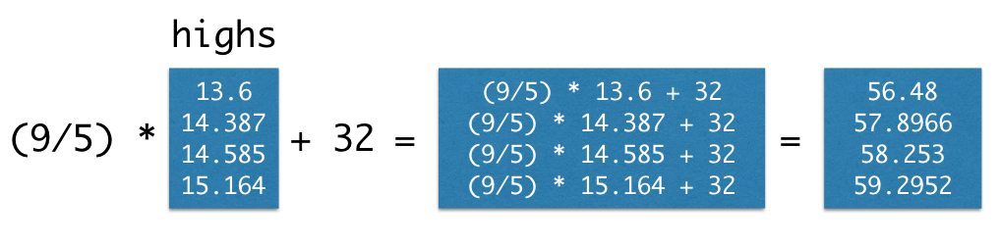

---
jupyter:
  anaconda-cloud: {}
  jupytext:
    notebook_metadata_filter: anaconda-cloud,language_info
    text_representation:
      extension: .Rmd
      format_name: rmarkdown
      format_version: '1.2'
      jupytext_version: 1.19.5
  kernelspec:
    display_name: Python 3 (ipykernel)
    language: python
    name: python3
  language_info:
    codemirror_mode:
      name: ipython
      version: 3
    file_extension: .py
    mimetype: text/x-python
    name: python
    nbconvert_exporter: python
    pygments_lexer: ipython3
    version: 3.14.7
---

# NumPy and NumPy Arrays

```{note}
This page is adapted from [Brett, Rush, Adhikari, Denero and Wagner (2023)](https://odsti.github.io/cfd-textbook/lists.html). See the [license](https://github.com/pxr687/Intro_Comp_Programming/blob/main/license.md) page for more information.
```

Sequences (also called collections or groups) are used to store more than one value in the same place.

There are several kinds of sequences in Python.  A
[list](https://pxr687.github.io/Intro_Comp_Programming/1_10_01_Lists.html) is one. However, the sequence type that we will use most in the class, is the NumPy array.

The `numpy` package, abbreviated `np` in programs, provides Python programmers
with convenient and powerful functions for creating and manipulating arrays.

NumPy means "Numerical Python". NumPy is widely used in data science, engineering, finance, economics, business analytics, and scientific research.

Let's use an import statement to get the functions from the Numpy library.

```{python}
# Load the Numpy package, and call it "np".
import numpy as np
```

## Making arrays


The `array` function from the Numpy package creates an array from single values, or sequences of values.

For example, remember `my_list`?

```{python}
my_list = [1, 2, 3]
```

This is a `list`:

```{python}
type(my_list)
```

The `np.array()` function from Numpy can make an array from this list:

```{python}
my_array = np.array(my_list)
my_array
```

As you can see from the display above, this is an array.  We check it with `type`:

```{python}
type(my_array)
```

We can also create the list and then the array in one call, like this:

```{python}
my_array = np.array([1, 2, 3])
my_array
```

Here `[1, 2, 3]` is an *expression* that returns a list. `np.array` then operates on the returned list, to create an array.

Arrays often contain numbers, but, like lists, they can also contain strings
or other types of values.  However, a single array can only contain a single
kind of data. (It usually doesn't make sense to group together unlike data
anyway.)

For example,

```{python}
english_parts_of_grammar = np.array(["noun", "pronoun", "verb", "adverb", "adjective", "conjunction", "preposition", "interjection"])
english_parts_of_grammar
```

We have not seen this yet, but Python lets us to spread expressions between
round and square brackets across many lines.  

It knows that the expression has not finished yet because it is waiting for the closing bracket.  For example, this cell works in the exactly the same way as the cell above, and may be easier to read:

```{python}
# An expression between brackets spread across many lines.
english_parts_of_grammar = np.array(
    ["noun",
    "pronoun",
    "verb",
    "adverb",
    "adjective",
    "conjunction",
    "preposition",
    "interjection"]
    )
english_parts_of_grammar
```

Below, we put four different temperatures into a list called `temps`. 

These
are the estimated average daily high temperatures over all land on Earth (in
degrees Celsius) for the decades around 1850, 1900, 1950, and 2000.

These values are deviations from the average absolute high
temperature between 1951 and 1980, which was 14.48 degrees.

If you are interested, you can get more data from [the Berkeley Earth
project](https://berkeleyearth.org/data/).

```{python}
highs = np.array([13.6, 14.387, 14.585, 15.164])
highs
```

## Maths with arrays


Arrays can be used in arithmetic/mathematical expressions.

When an array is used in a calculation with a single number, that number is combined with
each element of the array. 

Therefore, we can convert all of these temperatures
to Fahrenheit by writing the familiar conversion formula.

*Note*: the temperatues in the `highs` array are in Celsius.

```{python}
(9/5) * highs + 32
```




As we saw for strings, lists and dictionaries, arrays also have *methods*. 

Methods are functions that operate on the array values. 

The `mean` of a collection of numbers is its
average value: the sum divided by the length. 

Each pair of parentheses in the
examples below is part of a call expression; it's calling a function with no
arguments to perform a computation on the array called `highs`.

```{python}
# The `highs` array.
highs
```

```{python}
# The number of elements in the array.
highs.size
```

```{python}
# Add together all of the array elements.
highs.sum()
```

```{python}
# Get the average of the values in the array.
highs.mean()
```

## Functions on Arrays


Numpy provides various useful functions for operating on arrays.

For example, the `diff` function calculates the difference between each
pair of elements in an array. The first element of the `diff` is the second
element minus the first.

```{python}
np.diff(highs)
```

Let's make this clearer on another array, with integer numbers:

```{python}
ages_array = np.array([19, 21, 29, 45])

np.diff(ages_array)
```

19 is 2 less than 21.

21 is 8 less than 29.

29 is 16 less than 45.

So `np.diff()` gives us the difference between values in the array that are next to each other.

<!-- #region -->
The [full Numpy reference](http://docs.scipy.org/doc/numpy/reference/) shows all of
these functions, but only a small amount are used commonly for
data processing applications. 

These are grouped into different packages within
`np`. Learning this vocabulary is an important part of learning the Python
language, so go back to this list often as you work through examples and
problems.

However, you **don't need to memorize these**.  Use this as a reference.

Each of these functions takes an array as an argument and returns a single
value.

| **Function**       | Description                                                          |
|--------------------|----------------------------------------------------------------------|
| `np.sum`           | Add all elements together                                            |
| `np.prod`          | Multiply all elements together                                       |
| `np.all`           | Test whether all elements are true values (non-zero numbers are true)|
| `np.any`           | Test whether any elements are true values (non-zero numbers are true)|
| `np.count_nonzero` | Count the number of non-zero elements                                |
| `np.mean`          | Calculate the mean (sum divided by number of elements)               |
| `np.min`           | The minimum over the array                                           |
| `np.max`           | The maximum over the array                                           |

Each of these functions takes an array as an argument and returns an array of values.

| **Function**       | Description                                                          |
|--------------------|----------------------------------------------------------------------|
| `np.diff`          | Difference between adjacent elements                                 |
| `np.round`         | Round each number to the nearest integer (whole number)              |
| `np.abs`           | Absolute value of each number (remove minus signs                    |
| `np.cumprod`       | A cumulative product: for each element, multiply all elements so far |
| `np.cumsum`        | A cumulative sum: for each element, add all elements so far          |
| `np.exp`           | Exponentiate each element                                            |
| `np.log`           | Take the natural logarithm of each element                           |
| `np.sqrt`          | Take the square root of each element                                 |
| `np.sort`          | Sort the elements                                                    |

Each of these functions takes an array of strings and returns an array.

| **Function**        | **Description**                                              |
|---------------------|--------------------------------------------------------------|
| `np.char.lower`     | Lowercase each element                                       |
| `np.char.upper`     | Uppercase each element                                       |
| `np.char.strip`     | Remove spaces at the beginning or end of each element        |
| `np.char.isalpha`   | Whether each element is only letters (no numbers or symbols) |
| `np.char.isnumeric` | Whether each element is only numeric (no letters)

Each of these functions takes both an array of strings and a *search string*; each returns an array.

| **Function**         | **Description**                                                                  |
|----------------------|----------------------------------------------------------------------------------|
| `np.char.count`      | Count the number of times a search string appears among the elements of an array |
| `np.char.find`       | The position within each element that a search string is found first             |
| `np.char.rfind`      | The position within each element that a search string is found last              |
| `np.char.startswith` | Whether each element starts with the search string                               |


We'll look at little closer at some of these on the next pages...
<!-- #endregion -->
