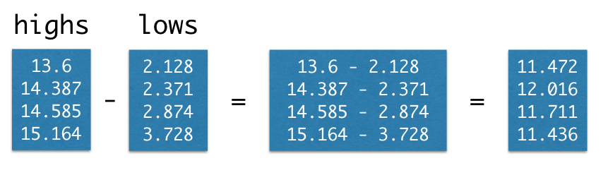

---
jupyter:
  anaconda-cloud: {}
  jupytext:
    notebook_metadata_filter: anaconda-cloud,language_info
    text_representation:
      extension: .Rmd
      format_name: rmarkdown
      format_version: '1.2'
      jupytext_version: 1.19.5
  kernelspec:
    display_name: Python 3 (ipykernel)
    language: python
    name: python3
  language_info:
    codemirror_mode:
      name: ipython
      version: 3
    file_extension: .py
    mimetype: text/x-python
    name: python
    nbconvert_exporter: python
    pygments_lexer: ipython3
    version: 3.14.7
---

# Maths with Arrays

```{note}
This page is adapted from [Brett, Rush, Adhikari, Denero and Wagner (2023)](https://odsti.github.io/cfd-textbook/More_on_Arrays.html). See the [license](https://github.com/pxr687/Intro_Comp_Programming/blob/main/license.md) page for more information.
```

We often need to calculate something that involves data from more than one
array. If two arrays are the same size, Python makes it easy to do
calculations involving both arrays.

For our first example, we return once more to the temperature data.  This time,
we create arrays of average daily
[high](http://berkeleyearth.lbl.gov/auto/Regional/TMAX/Text/global-land-TMAX-Trend.txt)
and
[low](http://berkeleyearth.lbl.gov/auto/Regional/TMIN/Text/global-land-TMIN-Trend.txt)
temperatures for the decades around 1850, 1900, 1950, and 2000.

First we get Numpy, renamed as `np`:

```{python}
import numpy as np
```

Next we create the array:

```{python}
highs = np.array([13.6, 14.387, 14.585, 15.164])
highs
```

```{python}
lows = np.array([2.128, 2.371, 2.874, 3.728])
lows
```

Imagine we'd like to calculate the average daily *range* of temperatures for
each decade. This means we want to subtract the average daily high in the 1850s
from the average daily low in the 1850s, and the same for each other decade.

We could write this in a long, slow way using using the `.item()` method:

```{python}
np.array([
    highs.item(0) - lows.item(0),
    highs.item(1) - lows.item(1),
    highs.item(2) - lows.item(2),
    highs.item(3) - lows.item(3)
])
```

Just like when we converted an array of temperatures from Celsius to Fahrenheit,
Python gives a much cleaner way to write this:

```{python}
highs - lows
```




What we've seen in these examples are special cases of a general feature of arrays.


## Elementwise arithmetic on two numeric arrays

If an arithmetic operator is used on two arrays of the same size, then the
operation is performed on each matching pair of elements in the two
arrays. The result is an array.

For example, if `array1` and `array2` have the same number of elements, then
the value of `array1 * array2` is an array. Its first element is the first
element of `array` times the first element of `array2`, its second element is
the second element of `array1` times the second element of `array2`, and so
on.

```{python}
array1 = np.array([1, 2, 3])

array2 = np.array([6, 10, 2])

array1 * array2
```

This is one big advantage of Numpy arrays over Python lists, for using numeric data. This is why Numpy arrays are used a lot in data science and scientific computing.

If we try the same thing with lists, we get an error:

```{python tags=c("raises-exception")}
list1 = [1, 2, 3]
list2 = [6, 10, 2]

list1 * list2
```
