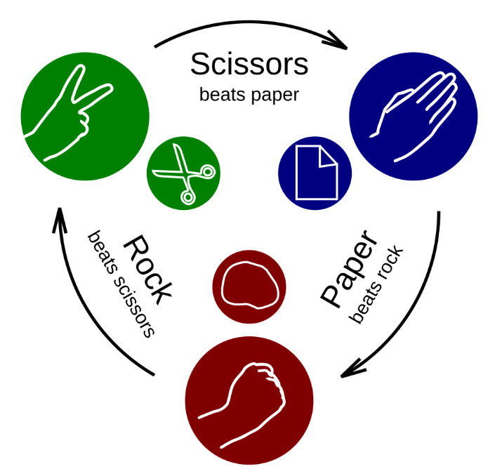

---
jupyter:
  jupytext:
    split_at_heading: true
    text_representation:
      extension: .Rmd
      format_name: rmarkdown
      format_version: '1.2'
      jupytext_version: 1.19.5
  kernelspec:
    display_name: Python 3 (ipykernel)
    language: python
    name: python3
---

# Simulation with NumPy Arrays Task: Rock, Paper, Scissors

Using the tools from the [last](https://pxr687.github.io/Intro_Comp_Programming/1_10_03h_Simulation_With_Numpy_Arrays.html) [pages](https://pxr687.github.io/Intro_Comp_Programming/1_10_03i_Iteration_For_Loops.html) you will now make your own probability simulation!

Imagine your friend tells you he has a good strategy for beating people at [rock, paper, scissors](https://en.wikipedia.org/wiki/Rock_paper_scissors):



Your friend says:

> "I beat everyone at rock, paper, scissors. That's because everyone else chooses "rock", "paper" or "scissors" randomly, but I only ever choose "rock" or "scissors". It's the way to win!

Is your friend correct? Make a simulation to test his strategy against a normal player, who is choosing randomly.

Before you do this **think hard** about what your simulation should do. Write out the steps on paper. Discuss it with other people.

**DO NOT ASK AN AI**. It will just write the code for you, without you needing to think. You'll learn a lot more/get a lot better practice from doing this yourself. 

Remember, you can simulate one person's choice of rock, paper or scissors using:

```{python}
# Load the Numpy package, and rename to "np".
import numpy as np

np.random.choice(['ROCK', 'PAPER', 'SCISSORS'])
```

Unless you tell it to do something different, `np.random.choice()` will get a random element from the list *with equal probability* for each element.

So, if there are three elements, each has a $\frac{1}{3}$ probability of being chosen. (This is the strategy a normal player will use).

If we want to use different probabilities, which we need to do to simulate your friend's strategy, we can use the `p = ` argument, and give it a list of probability values.

For instance, the following code means `np.random.choice()` will use these probabilities:

- `"ROCK"` $\frac{50}{100}$ probability.
- `"PAPER"` $\frac{25}{100}$ probability.
- `"SCISSORS"` $\frac{25}{100}$ probability.

```{python}
np.random.choice(['ROCK', 'PAPER', 'SCISSORS'],
                 p = [50/100, 25/100, 25/100])
```

The list of probabilites *must add up to 1* - otherwise mathematicians will come and fight with you.

Remember your friend's idea is that:

> "I beat everyone at rock, paper, scissors. That's because everyone else chooses "rock", "paper" or "scissors" randomly, but I only ever choose "rock" or "scissors". It's the way to win!

Is he right? Use a simulation to decide.

The tools you need for this are:

- making an array to fill

- `for` loops

- `np.random.choice()`

- Boolean arrays and conditional statements

- Using `np.sum()` to count the number of `True` values in Boolean arrays

*Note*: there is not just one correct way to do this. The easier way is to write two separate chunks of code: one which uses a normal strategy against a normal player. One which uses your friend's big brain high IQ strategy, also against a normal player.

Experiment with plotting using `matplotlib` to show the results of your simulation.

```{python}
# Your code here.
```
