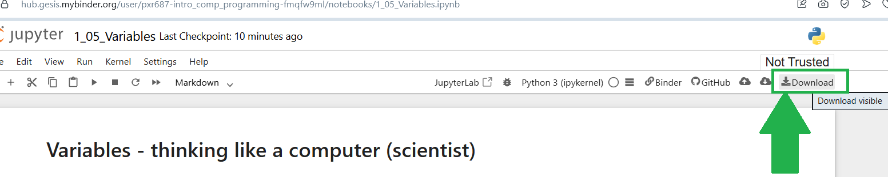

---
jupyter:
  jupytext:
    text_representation:
      extension: .Rmd
      format_name: rmarkdown
      format_version: '1.2'
      jupytext_version: 1.19.5
  kernelspec:
    display_name: Python 3 (ipykernel)
    language: python
    name: python3
---

# Exercise - Ranges & Filling Arrays

If you need help, open the _[textbook page](https://pxr687.github.io//Intro_Comp_Programming/1_10_03f_Filling_Arrays.html)_ for this exercise.

## Instructions

**IMPORTANT**: If you see a comment which says `# DO NOT CHANGE THIS CODE` then **DO NOT CHANGE THAT CODE**. You will probably break the exercise if you do...

**First, run the code cell below**. Click on the cell, then press `Shift + Enter`:

```{python}
# RUN THIS CELL - DO NOT CHANGE THE CODE.
import numpy as np
from jupyprint import jupyprint
```

**ALSO IMPORTANT**: in **ALL** exercises, and **ALL** assignments/tests/exams. You **MUST** use the right variable names in your answers.

If the question says "make a variable called `answer_1`" you **MUST** call you variable `answer_1` or you will **NOT** get a mark.

If the question says "make a variable called `me_and_my_cat`" you **MUST** call you variable `me_and_my_cat` or you will **NOT** get a mark.

### Downloading your work

*Binder will NOT save your work*. If you are working on Binder, when you finish all of the questions, you can download your work as an `.ipynb` file, by clicking the button shown below:



When you download your work, you can view it by uploading the file here: https://code-format.com/ipynb-viewer

Later in the course we will install Python on your own laptop...


## Question 1

There are lots of reasons we may want to make an array with lots of the same value.

One common reason is when we want to fill the array up with data - but first we need something to put that data in.

These exercises will check you know how to make different types of filled array, with different types of data. If you can do this you can get arrays ready to do data analysis with many different types of data.

*Hint:* you might have to search Google as well as the textbook pages to find which Numpy functions you need here.

First, make a Numpy array containing 10,000 zeros. Save your array in the variable `answer_1`:

```{python}
# Type your answer below.
answer_1 = ...
```

### Run the next cell to mark your answer.

You will get error messages if your answer is wrong.

```{python}
# DO NOT CHANGE THIS CODE.
# RUN THIS CELL TO MARK YOUR ANSWER.
assert len(answer_1) == 10_000, "Your array has the wrong number of values!"
assert all(answer_1 == 0), "Your array contains somethng that is not 0!"
jupyprint('*That is **CORRECT**, well done!*')
```


## Question 2

Make a array containing 100,000 empty strings. Save your array in the variable `answer_2`:

```{python}
# Type your answer below.
answer_2 = ...
```

### Run the next cell to mark your answer.

```{python}
# DO NOT CHANGE THIS CODE.
# RUN THIS CELL TO MARK YOUR ANSWER.
assert len(answer_2) == 100_000, "Your array has the wrong number of values!"
assert all(answer_2 == ''), "Your array contains somethng that is not an empty string!"
jupyprint('*That is **CORRECT**, well done!*')
```


## Question 3

Make an array that has the numbers 0 to 1000, going up by 2 each time. So the first six numbers should be:

`0,    2,    4,    6,    8,   10`

and the last six numbers should be:

`990,  992,  994,  996,  998, 1000`

Save your array in the variable `answer_3`:

```{python}
# Type your answer below.
answer_3 = ...
```

### Run the next cell to mark your answer.

```{python}
# DO NOT CHANGE THIS CODE.
# RUN THIS CELL TO MARK YOUR ANSWER.
assert len(answer_3) == 501, "Your array has the wrong number of values!"
assert answer_3.min() == 0, "Your array has the wrong start value!"
assert answer_3.max() == 1000, "Your array has the wrong end value!"
assert answer_3.sum() == 250500, "Your array does not contain the right numbers!"
jupyprint('*That is **CORRECT**, well done!*')
```


## Question 4

Make an array that contains [12,000](https://en.wikipedia.org/wiki/12,000_(number)) repeats of the string:

```
"""
12,000 from the tribe of Judah were sealed,
12,000 from the tribe of Reuben,
12,000 from the tribe of Gad,
12,000 from the tribe of Asher,
12,000 from the tribe of Naphtali,
12,000 from the tribe of Manasseh,
12,000 from the tribe of Simeon,
12,000 from the tribe of Levi,
12,000 from the tribe of Issachar,
12,000 from the tribe of Zebulun,
12,000 from the tribe of Joseph,
12,000 from the tribe of Benjamin were sealed.
"""
```

Save your answer in a variable called `answer_4`:

```{python}
# Type your answer below.
answer_4 = ...
```

### Run the next cell to mark your answer.

```{python}
# DO NOT CHANGE THIS CODE.
# RUN THIS CELL TO MARK YOUR ANSWER.
string_test = """
12,000 from the tribe of Judah were sealed,
12,000 from the tribe of Reuben,
12,000 from the tribe of Gad,
12,000 from the tribe of Asher,
12,000 from the tribe of Naphtali,
12,000 from the tribe of Manasseh,
12,000 from the tribe of Simeon,
12,000 from the tribe of Levi,
12,000 from the tribe of Issachar,
12,000 from the tribe of Zebulun,
12,000 from the tribe of Joseph,
12,000 from the tribe of Benjamin were sealed.
"""
assert len(answer_4) == 12_000, "Your array contains the wrong number of values!"
assert all(answer_4 == string_test), "Your array contains the wrong values!"
jupyprint('*That is **CORRECT**, well done!*')
```


## Question 5

Make an array which has the first value of 10,000 then a last value of 2. Each value should go down by 1.

So the first three values should be:

`10000,  9999,  9998`

and the last three values should be:

`4,     3,     2`

Save your answer in a variable called `answer_5`:

```{python}
# Type your answer below.
answer_5 = ...
```

### Run the next cell to mark your answer.

```{python}
# DO NOT CHANGE THIS CODE.
# RUN THIS CELL TO MARK YOUR ANSWER.
assert answer_5[0] == 10_000, "Hmmm, your array starts with the wrong value..."
assert answer_5[-1] == 2, "Hmmm, your array ends with the wrong value..."
assert len(answer_5) == 9999, "Your array contains the wrong number of values..."
assert all(np.diff(answer_5) == -1), "Your array does not always go down by 1..."
jupyprint('*That is **CORRECT**, well done!*')
```


## Question 6

Make an array that goes from 1 to 997 in steps of 3.

So the first four numbers should be: 

`1,   4,   7,  10`

and the last four numbers should be:

`991,  994,  997, 1000`

If you do this right, your array should have 334 values in it.

Save your array in a variable called `answer_6`:

```{python}
# Type your answer below.
answer_6 = ...
```

### Run the next cell to mark your answer.

```{python}
# DO NOT CHANGE THIS CODE.
# RUN THIS CELL TO MARK YOUR ANSWER.
assert len(answer_6) == 334, "Your array has the wrong number of values in it!"
assert answer_6[0] == 1, "Your array has the wrong first value!"
assert answer_6[-1] == 1000, "Your array has the wrong last value!"
assert all(np.diff(answer_6) == 3), "Your array does not always go up by 3!"
```


## Go back to the textbook:

Click _[here](https://pxr687.github.io/Intro_Comp_Programming/index.html)_ to go back to the course textbook.
