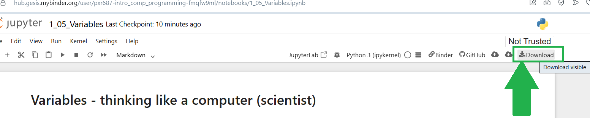

---
jupyter:
  jupytext:
    text_representation:
      extension: .Rmd
      format_name: rmarkdown
      format_version: '1.2'
      jupytext_version: 1.19.5
  kernelspec:
    display_name: Python 3 (ipykernel)
    language: python
    name: python3
---

# Exercise - Boolean Arrays & Boolean Indexing

If you need help, open the _[textbook page](https://pxr687.github.io//Intro_Comp_Programming/1_10_03g_Boolean_Arrays_Boolean_Indexing.html)_ for this exercise.
*Note:* this exercise is adapted from the Boolean Arrays exercise from [ODSTI](https://github.com/odsti).

## Instructions

**IMPORTANT**: If you see a comment which says `# DO NOT CHANGE THIS CODE` then **DO NOT CHANGE THAT CODE**. You will probably break the exercise if you do...

**First, run the code cell below**. Click on the cell, then press `Shift + Enter`:

```{python}
# RUN THIS CELL - DO NOT CHANGE THE CODE.
import numpy as np
from jupyprint import jupyprint
import pandas as pd
mmd = pd.read_csv('data/movies.csv')
us_mmd = mmd[mmd['country'] == 'USA']
top_ten = us_mmd.head(25)
titles = np.array(top_ten['title'])
budgets = np.array(top_ten['budget'])
gross_earnings = np.array(top_ten['gross'])
```

**ALSO IMPORTANT**: in **ALL** exercises, and **ALL** assignments/tests/exams. You **MUST** use the right variable names in your answers.

If the question says "make a variable called `answer_1`" you **MUST** call you variable `answer_1` or you will **NOT** get a mark.

If the question says "make a variable called `me_and_my_cat`" you **MUST** call you variable `me_and_my_cat` or you will **NOT** get a mark.

### Downloading your work

*Binder will NOT save your work*. If you are working on Binder, when you finish all of the questions, you can download your work as an `.ipynb` file, by clicking the button shown below:



When you download your work, you can view it by uploading the file here: https://code-format.com/ipynb-viewer

Later in the course we will install Python on your own laptop...


## Question 1

The first cell of this notebook made three arrays, each with 25 elements, corresponding to the top 25
movies made in the USA, by [IMDB rating](https://www.imdb.com/).

Here are the movie `titles`:

```{python}
titles
```

Here are the `budgets` in dollars (so the first budget is for `'The Shawshank Redemption`, the second budget is for `The Godfather` etc.):

```{python}
budgets
```

The next array has how much money each film made, as `gross_earnings`:

```{python}
gross_earnings
```

Make a new array called `pct_profit`, that has one element per film,
and where each element is the result of dividing the film's gross earnings by
its budget, and multiplying by 100. So:

$ \frac{\text{gross_earnings}}{\text{budget}} * 100 $

```{python}
# Type your answer below.
pct_profit = ...
```

### Run the next cell to mark your answer.

You will see error messages if your answer is wrong.

```{python}
# DO NOT CHANGE THIS CODE.
# RUN THIS CELL TO MARK YOUR ANSWER.
assert len(pct_profit) == 25, "Your array contains the wrong number of values!"
assert np.isclose(pct_profit.sum(), 18430.30), "Hmmm it looks like your array does not contain the right values!"
jupyprint('*That is **CORRECT**, well done!*')
```


## Question 2

These are the US films with the highest IMDB score, so they were all very successful.  

In the next cell, make a Boolean array `profit_gt_500`
that has True for corresponding films that grossed more than 500% of their
budget, and False otherwise.


```{python}
# Type your answer below.
profit_gt_500 = ...
```

### Run the next cell to mark your answer.

```{python}
# DO NOT CHANGE THIS CODE.
# RUN THIS CELL TO MARK YOUR ANSWER.
assert profit_gt_500[0] == False, "Hmmm it looks your array contains the wrong Boolean values!"
assert profit_gt_500[-1] == True, "Hmmm it looks your array contains the wrong Boolean values!"
assert np.count_nonzero(profit_gt_500) == np.sqrt((16/2)**(4/2)), "Hmmm it looks your array contains the wrong Boolean values!"
jupyprint('*That is **CORRECT**, well done!*')
```


## Question 3

How many films of these 25 made more than 500% of their budget in gross
earnings?  Put the result in the variable `n_big_earners` (where `n_` means *number* e.g. the number of films which made more than 500% profit).

Do **not** hard-code your answer, get it via Python operations...:

```{python}
# Type your answer below.
n_big_earners = ...
```

### Run the next cell to mark your answer.

```{python}
# DO NOT CHANGE THIS CODE.
# RUN THIS CELL TO MARK YOUR ANSWER.
assert np.count_nonzero(profit_gt_500) == 101 * np.sqrt((16/2)**(4/2)) / 101, "Hmmm that is not right..."
jupyprint('*That is **CORRECT**, well done!*')
```


## Question 4

Use [Boolean indexing](1_10_03g_Boolean_Arrays_Boolean_Indexing) to find
the film titles for films with gross earnings over 500% of their budget.  Store
these film titles in the array `big_earner_titles`.

```{python}
# Type your answer below.
big_earner_titles = ...
```

### Run the next cell to mark your answer.

```{python}
# DO NOT CHANGE THIS CODE.
# RUN THIS CELL TO MARK YOUR ANSWER.
assert big_earner_titles[0].startswith("The G"), "Looks like your first value is wrong..."
assert big_earner_titles[-1].startswith("Bac"), "Looks like your last value is wrong..."
assert len(big_earner_titles) == 8, "Looks like your array has the wrong number of values..."
jupyprint('*That is **CORRECT**, well done!*')
```


## Question 5

The world does not just contain winners, even among these highly-rated films.

Use Boolean indexing to find and show the film titles where percent profit was
less than 100.  Put these titles into the variable `relative_loser_titles`.

```{python}
# Type your answer below.
relative_loser_titles = ...
```

### Run the next cell to mark your answer.

```{python}
# DO NOT CHANGE THIS CODE.
# RUN THIS CELL TO MARK YOUR ANSWER.
assert relative_loser_titles[0].startswith("Fig"), "Looks like your first value is wrong..."
assert relative_loser_titles[-1].startswith("Mod"), "Looks like your last value is wrong..."
assert len(relative_loser_titles) == 3, "Looks like your array has the wrong number of values..."
jupyprint('*That is **CORRECT**, well done!*')
```


## Question 6

The noun *snob* means:

> A snob is a person who believes they are better than others based on wealth, social status, education, or refined taste, and looks down on or treats people they consider not as good as themself.

You have just discovered you are a big snob for high earning movies.  You want to tell
the world.  First you make a new `.copy()` of the `titles` array to prepare to give
your own version of some titles.

Call your array `my_titles`:

```{python}
# Type your answer below.
my_titles = ...
```

### Run the next cell to mark your answer.

```{python}
# DO NOT CHANGE THIS CODE.
# RUN THIS CELL TO MARK YOUR ANSWER.
assert all(my_titles == titles), "Hmmm something has gone wrong here...did you copy the `titles` array?"
jupyprint('*That is **CORRECT**, well done!*')
```


## Question 7

Now express your dislike of the lower-earning films by replacing their
titles in `my_titles` with the new title `"Who cares?"`.  Use Boolean indexing to
do the assignment.

```{python}
# Type your answer below.
my_titles = ...
```

### Run the next cell to mark your answer.

```{python}
# DO NOT CHANGE THIS CODE.
# RUN THIS CELL TO MARK YOUR ANSWER.
assert np.sum(my_titles == 'Who cares?') == 3, "Hmmm look like you have the wrong number of 'Who cares?' in your `my_titles` array..."
assert np.sum(my_titles[-4:-2] == 'Who cares?') + (my_titles[10] == 'Who cares?') == 3, "Hmmm some of your 'Who cares?' are not in the right place in the array..."
jupyprint('*That is **CORRECT**, well done!*')
```


## Done.

Congratulations, you're done with the exercise!

## Go back to the textbook:

Click _[here](https://pxr687.github.io/Intro_Comp_Programming/index.html)_ to go back to the course textbook.
