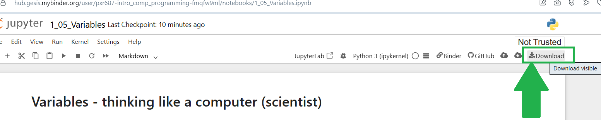

---
jupyter:
  jupytext:
    text_representation:
      extension: .Rmd
      format_name: rmarkdown
      format_version: '1.2'
      jupytext_version: 1.19.5
  kernelspec:
    display_name: Python 3 (ipykernel)
    language: python
    name: python3
---

# Exercise - `for` loops

If you need help, open the _[textbook page](https://pxr687.github.io//Intro_Comp_Programming/1_10_03i_Iteration_For_Loops.html)_ for this exercise. *Note*: this exercise is adapted from the `for` loop exercise from [ODSTI](https://github.com/odsti).

## Instructions

**IMPORTANT**: If you see a comment which says `# DO NOT CHANGE THIS CODE` then **DO NOT CHANGE THAT CODE**. You will probably break the exercise if you do...

**First, run the code cell below**. Click on the cell, then press `Shift + Enter`:

```{python}
# RUN THIS CELL - DO NOT CHANGE THE CODE.
import numpy as np
from jupyprint import jupyprint
```

**ALSO IMPORTANT**: in **ALL** exercises, and **ALL** assignments/tests/exams. You **MUST** use the right variable names in your answers.

If the question says "make a variable called `answer_1`" you **MUST** call you variable `answer_1` or you will **NOT** get a mark.

If the question says "make a variable called `me_and_my_cat`" you **MUST** call you variable `me_and_my_cat` or you will **NOT** get a mark.

### Downloading your work

*Binder will NOT save your work*. If you are working on Binder, when you finish all of the questions, you can download your work as an `.ipynb` file, by clicking the button shown below:



When you download your work, you can view it by uploading the file here: https://code-format.com/ipynb-viewer

Later in the course we will install Python on your own laptop...


## Questions

**This exercise will not always mark your answers...BUT you can see if your answers are correct, each question will tell you what you shoud see when your code runs correctly...**

All the cells below have errors in syntax or in logic. 

A syntax error happens when the code does not follow to Python's rules; Python generates an error
with some information about which bit of the code caused the problem.  

A logic error is where the code does run, but does not do what it was meant to do.
Run the cells to see the error, and then fix them to work correctly.

## Question 1

Use a `for` loop to print the strings `"ROCK"` `"PAPER"` `"SCISSORS"`

```{python tags=c("raises-exception")}
# Write your `for` loop here.
for "ROCK", "PAPER", "SCISSORS"
```

**CHECK YOUR ANSWER:** When your code runs correctly you should see this below the cell:

```
ROCK
PAPER
SCISSORS
```

## Question 2

Write a `for` loop which adds up all the numbers from 3 to 10.

The final result should be in a variable called `total`. 

```{python tags=c("raises-exception")}
# Add up all the numbers from 3 through 10
total = 0
for ...

# Don't change this `print()` statement, it will show you your result.
print(total)
```

**CHECK YOUR ANSWER:** When your code runs correctly you should see the number **52** as the output of the code cell above.


## Question 3

Now, print all of the numbers from 5 to 9.

```{python tags=c("raises-exception")}
#  Print all the numbers from 5 through 9
for p in 56789:
    print(p)
```

**CHECK YOUR ANSWER:** When your code runs correctly you should see this:

```
5
6
7
8
9
```


## Question 4

Write a `for` loop that adds up all the numbers from 3 going down to -2 (including -2).

Store your result in a variable called `total2`.

```{python tags=c("raises-exception")}
# Add all numbers from 3 down to -2, inclusive
total2 = 0

for 3210-1-2 ...


# Don't change this `print()` statement, it will show you your result.
print(total2)
```

**CHECK YOUR ANSWER:**  When your code runs correctly, you should see the number **3**.


## Question 6

Here is an array of areas in Bangkok:

```{python}
bangkok_areas = np.array(["Sukhumvit",
                          "Silom",
                          "Sathorn",
                          "Siam",
                          "Chinatown",
                          "Ari",
                          "Bang Wa",
                          "Thonglor",
                          "Rattanakosin"])
bangkok_areas
```

Write a `for` loop that will:

- loop over the area names and...

- `print()`s each area name

- `print()`s the string `"Begins with 's'!"` when the loop hits `"Sukhumvit"`, `"Silom"`, `"Sathorn"`, and `"Siam"`

- `print()`s the string `"Time to be a tourist!"` for `Chinatown`, `Ari`, `Thonglor` and `Rattanakosin`

- `prints()`s the string `"Uh oh...time for class!"` for `Bang Wa`

*Hint*: there is more than one way to do this correctly...

```{python tags=c("raises-exception")}
for all the bangkok_areas:
    DO WHAT I WANT!
```

**CHECK YOUR ANSWER**: When your code runs correctly you should see this:
```
Sukhumvit
Begins with 's'!
Silom
Begins with 's'!
Sathorn
Begins with 's'!
Siam
Begins with 's'!
Chinatown
Time to be a tourist!
Ari
Time to be a tourist!
Bang Wa
Uh oh...time for class!
Thonglor
Time to be a tourist!
Rattanakosin
Time to be a tourist!
```


## Question 7

Fix the `for` loop in the cell below.

When the code runs correctly you should see:

```
100
200
300
400
500
600
700
800
900
1000
1100
1200
1300
1400
1500
1600
1700
1800
1900
```

...and a message saying that your fixed the code:

```{python tags=c("raises-exception")}
for val in np.arange(100, 2000, 100)
print(val)

# Do not change the code below, it just tells you that you fixed the `for` loop.
jupyprint('*Well done for fixing that!*')
```

## Question 8

Fix the code in the cell below.

It should loop over an array of the names of Chinese cities.

For each city it should show a message saying something like `"Beijing is a city in China!"`.

When the code runs correctly you should see:

```
Beijing is a city in China!
Shanghai is a city in China!
Guangzhou is a city in China!
Shenzhen is a city in China!
Chengdu is a city in China!
Xi'an is a city in China!
Hangzhou is a city in China!
Chongqing is a city in China!
Nanjing is a city in China!
Wuhan is a city in China!
Suzhou is a city in China!
Tianjin is a city in China!
Hong Kong is a city in China!
Macau is a city in China!
Qingdao is a city in China!
Kunming is a city in China!
```

...and a message saying that your fixed the code:

```{python tags=c("raises-exception")}
chinese_cities = np.array("Beijing", "Shanghai", "Guangzhou", "Shenzhen", "Chengdu", "Xi'an",
                           "Hangzhou", "Chongqing", "Nanjing", "Wuhan", "Suzhou", "Tianjin",
                           "Hong Kong", "Macau", "Qingdao", "Kunming")

for chinese_cities:
     print("{city} is a city in China!")

# Do not change the code below, it just tells you that you fixed the `for` loop.
jupyprint('*Well done for fixing that!*')
```

## Question 9

Fix the code in the cell below.

It should loop over an array of the names of American cities.

For each city it should show the city name, then the city name in ALL CAPITAL LETTERS on the next line, then the city name in all lowercase letters on the next line.

So, when the code runs correctly you should see:

```
New York
NEW YORK
new york
Los Angeles
LOS ANGELES
los angeles
Chicago
CHICAGO
chicago
San Francisco
SAN FRANCISCO
san francisco
Miami
MIAMI
miami
Las Vegas
LAS VEGAS
las vegas
Boston
BOSTON
boston
Washington DC
WASHINGTON DC
washington dc
Seattle
SEATTLE
seattle
Houston
HOUSTON
houston
Dallas
DALLAS
dallas
Austin
AUSTIN
austin
San Diego
SAN DIEGO
san diego
Philadelphia
PHILADELPHIA
philadelphia
Denver
DENVER
denver
Atlanta
ATLANTA
atlanta
```

...and a message saying that your fixed the code:

```{python tags=c("raises-exception")}
american_cities = np.array([ "New York", "Los Angeles", "Chicago", "San Francisco",
                            "Miami", "Las Vegas", "Boston", "Washington DC", "Seattle",
                            "Houston", "Dallas", "Austin", "San Diego", "Philadelphia",
                            "Denver", "Atlanta"])

in city for as cities
print(city)
print(city BUT BIG LETTERS)
print(city BUT SMALL LETTERS)

# Do not change the code below, it just tells you that you fixed the `for` loop.
jupyprint('*Well done for fixing that!*')
```

<!-- #region -->
## Done.

You finished the exercise!


## Go back to the textbook:

Click _[here](https://pxr687.github.io/Intro_Comp_Programming/index.html)_ to go back to the course textbook.
<!-- #endregion -->
