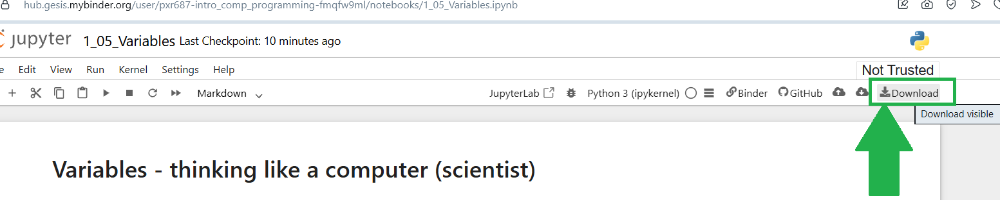

---
jupyter:
  jupytext:
    text_representation:
      extension: .Rmd
      format_name: rmarkdown
      format_version: '1.2'
      jupytext_version: 1.19.5
  kernelspec:
    display_name: Python 3 (ipykernel)
    language: python
    name: python3
---

# Exercise -  Statistical Simulation

If you need help, open the _[textbook page](https://pxr687.github.io//Intro_Comp_Programming/1_10_03j2_Simulation_With_Numpy_Arrays.html)_ for this exercise. 

## Instructions

**IMPORTANT**: If you see a comment which says `# DO NOT CHANGE THIS CODE` then **DO NOT CHANGE THAT CODE**. You will probably break the exercise if you do...

**First, run the code cell below**. Click on the cell, then press `Shift + Enter`:

```{python}
# RUN THIS CELL - DO NOT CHANGE THE CODE.
import numpy as np
from jupyprint import jupyprint
```

**ALSO IMPORTANT**: in **ALL** exercises, and **ALL** assignments/tests/exams. You **MUST** use the right variable names in your answers.

If the question says "make a variable called `answer_1`" you **MUST** call you variable `answer_1` or you will **NOT** get a mark.

If the question says "make a variable called `me_and_my_cat`" you **MUST** call you variable `me_and_my_cat` or you will **NOT** get a mark.

### Downloading your work

*Binder will NOT save your work*. If you are working on Binder, when you finish all of the questions, you can download your work as an `.ipynb` file, by clicking the button shown below:



When you download your work, you can view it by uploading the file here: https://code-format.com/ipynb-viewer

Later in the course we will install Python on your own laptop...


## Doing your own statistical simulation

Here is your problem:

> In a family with 8 children, what is the probability of having exactly 2 boys?

Think about what you need to do to answer this question:

- simulate one family with 8 children

- repeat this many times (at least 1000 times)

- count the number of families with exactly 2 boys, and use this count to calculate a probability

Save your final probability value in a variable called `p_2_boys`.

After you finish your simulation, try to use `matplotlib` to plot the results of your simulation. So you should plot a histogram where each bar shows the count for each number of boys (e.g one bar to 0 boys, on bar for 1 boys and so on) from your simulation.

```{python}
# Your code here.
```

## Run this cell to check your answer.

```{python}
# Do not change this cell, just run it to check your answer.
assert 0.09 <= p_2_boys <= 0.13, "Hmmm your probability value looks wrong!"
from jupyprint import jupyprint
jupyprint("*Well done, that looks **CORRECT**!")
```

<!-- #region -->
## Done.

You finished the exercise!


## Go back to the textbook:

Click _[here](https://pxr687.github.io/Intro_Comp_Programming/index.html)_ to go back to the course textbook.
<!-- #endregion -->
