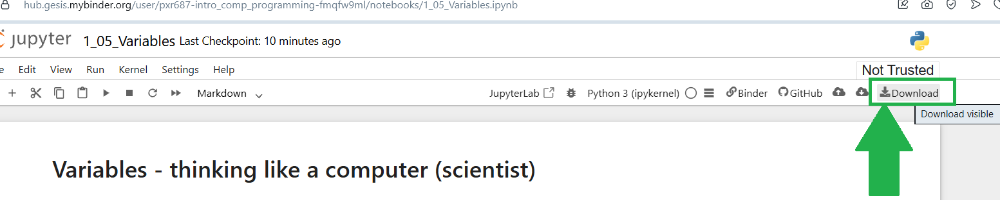

---
jupyter:
  jupytext:
    text_representation:
      extension: .Rmd
      format_name: rmarkdown
      format_version: '1.2'
      jupytext_version: 1.19.5
  kernelspec:
    display_name: Python 3 (ipykernel)
    language: python
    name: python3
---

# Exercise -  Statistical Simulation 2

If you need help, open the _[textbook page](https://pxr687.github.io//Intro_Comp_Programming/1_10_03j3_Simulation_to_Solve_a_Real_Problem.html)_ for this exercise. 

## Instructions

**IMPORTANT**: If you see a comment which says `# DO NOT CHANGE THIS CODE` then **DO NOT CHANGE THAT CODE**. You will probably break the exercise if you do...

**First, run the code cell below**. Click on the cell, then press `Shift + Enter`:

```{python}
# RUN THIS CELL - DO NOT CHANGE THE CODE.
import numpy as np
from jupyprint import jupyprint
```

**ALSO IMPORTANT**: in **ALL** exercises, and **ALL** assignments/tests/exams. You **MUST** use the right variable names in your answers.

If the question says "make a variable called `answer_1`" you **MUST** call you variable `answer_1` or you will **NOT** get a mark.

If the question says "make a variable called `me_and_my_cat`" you **MUST** call you variable `me_and_my_cat` or you will **NOT** get a mark.

### Downloading your work

*Binder will NOT save your work*. If you are working on Binder, when you finish all of the questions, you can download your work as an `.ipynb` file, by clicking the button shown below:



When you download your work, you can view it by uploading the file here: https://code-format.com/ipynb-viewer

Later in the course we will install Python on your own laptop...


## Doing your own statistical simulation, part 2

**DO NOT USE AI TO DO THIS**. It will do it for you in seconds, and you won't learn or practice anything. You can look at the code in the textbook, but try to write your own simulation *without looking* at the textbook code. This will make your brain work harder, and will increase your knowledge of statistial simulation, as well as how to do it in code.

Here is your problem:

> Your friend and you are playing a game where you each flip a coin. Whoever gets HEADS on each flip wins. You both flip 25 times. Your friend gets 15 heads. You think he is cheating by using an unfair coin (a coin that does NOT have a 50% chance of HEADS or TAILS). Perform a statistical simulation to see if you have good evidence that your friend is cheating.

Think carefully about what your code should do here. It should:

- flip a coin 25 times, and count the number of HEADS

- repeat this lots of times (at least 1000 times)

- see how often you get 15 OR MORE heads, in the simulation

- calculate the probability of getting 15 or more heads, over all the trials in the simulation

- decide if you think you can be sure your friend is cheating, based on your results

Store your probability in a variable called `p_15_or_more`.

When you are done, plot the results of your simulation using `matplotlib`.

```{python}
# Your code here.
```

## Run this cell to check your answer.

```{python}
# Do not change this cell, just run it to check your answer.
assert 0.19 <= p_15_or_more <= 0.22, "Hmmm your probability value looks wrong!"
from jupyprint import jupyprint
jupyprint("*Well done, that looks **CORRECT**!*")
```

<!-- #region -->
## Done.

You finished the exercise!


## Go back to the textbook:

Click _[here](https://pxr687.github.io/Intro_Comp_Programming/index.html)_ to go back to the course textbook.
<!-- #endregion -->
