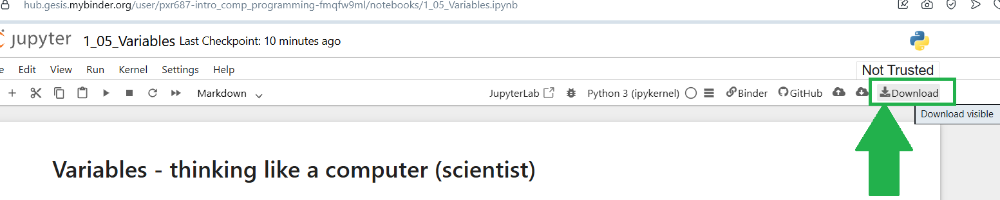

---
jupyter:
  jupytext:
    text_representation:
      extension: .Rmd
      format_name: rmarkdown
      format_version: '1.2'
      jupytext_version: 1.19.5
  kernelspec:
    display_name: Python 3 (ipykernel)
    language: python
    name: python3
---

# Exercise -  Going Loopy

If you need help, open the _[textbook](https://pxr687.github.io//Intro_Comp_Programming/1_10_03l2_While_Loops.html)[pages](https://pxr687.github.io//Intro_Comp_Programming/1_10_03l_Break_and_Continue.html)_ for this exercise. 

## Instructions

**IMPORTANT**: If you see a comment which says `# DO NOT CHANGE THIS CODE` then **DO NOT CHANGE THAT CODE**. You will probably break the exercise if you do...

**First, run the code cell below**. Click on the cell, then press `Shift + Enter`:

```{python}
# RUN THIS CELL - DO NOT CHANGE THE CODE.
import numpy as np
from jupyprint import jupyprint
```

**ALSO IMPORTANT**: in **ALL** exercises, and **ALL** assignments/tests/exams. You **MUST** use the right variable names in your answers.

If the question says "make a variable called `answer_1`" you **MUST** call you variable `answer_1` or you will **NOT** get a mark.

If the question says "make a variable called `me_and_my_cat`" you **MUST** call you variable `me_and_my_cat` or you will **NOT** get a mark.

### Downloading your work

*Binder will NOT save your work*. If you are working on Binder, when you finish all of the questions, you can download your work as an `.ipynb` file, by clicking the button shown below:



When you download your work, you can view it by uploading the file here: https://code-format.com/ipynb-viewer

Later in the course we will install Python on your own laptop...

<!-- #region -->
## More Loops

### Question 1

Exercise 2 – Using break

The break statement allows us to exit a loop early when a particular condition is met.

In the cell below you should:

1. Create one NumPy array called `temperatures` containing the values 12, 15, 18, 21, 24, 27, 30 and 33.


2. Use a `for` loop with the same number of repeats as there are in `temperatures`. You will want to use `len()` to count how many `temperatures` there are.


3. Use the loop variable as an index to access each temperature.


4. Print each temperature.


5. If a temperature reaches 24 or above, use break to stop the loop.


If you do this correctly, you should see:

```
12
15
18
21
24
```

Notice that the loop stops as soon as it reaches 24.
<!-- #endregion -->

```{python}
# Your code here.
```

### Question 2

<!-- #region -->
### Question 4

We can use a while loop to repeat instructions until a condition is no longer true.

Task:

1. Create a variable called `running_calculation` and set its value to `0`.


2. Use a `while` loop which will run whilst `running_calculation < 30` is `True`.


3. Each time the loop runs you should use `np.random.randint()` to add a random integer between 0 and 8 to `running_count`. Use a variable called `random_amount` to store this random integer. **You should `print()` the value of `running_count` *before* and *after* you add the random integer.** You should do this with a message like:

    - "Random amount on this repeat of the loop = X"

    - "Value of `running_calculation` BEFORE adding X = Y"

    - "Value of `running_calculation` AFTER adding X = Z"
    
...where X, Y and Z are the `random_amount`, and the values of `running_calculation` BEFORE and AFTER adding the random amount.

If you do this correctly you should see an output like this (it will be different because the loop uses randomness):
 
```
Random amount on this repeat of the loop = 5
Value of `running_calculation` BEFORE adding 5: 0
Value of `running_calculation` BEFORE adding 5: 5
Random amount on this repeat of the loop = 7
Value of `running_calculation` BEFORE adding 7: 5
Value of `running_calculation` BEFORE adding 7: 12
Random amount on this repeat of the loop = 7
Value of `running_calculation` BEFORE adding 7: 12
Value of `running_calculation` BEFORE adding 7: 19
Random amount on this repeat of the loop = 6
Value of `running_calculation` BEFORE adding 6: 19
Value of `running_calculation` BEFORE adding 6: 25
Random amount on this repeat of the loop = 6
Value of `running_calculation` BEFORE adding 6: 25
Value of `running_calculation` BEFORE adding 6: 31
``
<!-- #endregion -->

```{python}
# Your code here.
running_calculation = 0

while running_calculation < 30:
    random_amount = np.random.randint(0, 8)
    print(f'Random amount on this repeat of the loop = {random_amount}')
    print(f'Value of `running_calculation` BEFORE adding {random_amount}: {running_calculation}')
    running_calculation =  running_calculation + random_amount
    print(f'Value of `running_calculation` BEFORE adding {random_amount}: {running_calculation}')
```

<!-- #region -->
Cell 1 – Markdown

Exercise 1 – Counting with while

We can use a while loop to repeat instructions until a condition is no longer true.

Task:

1. Create one NumPy array called numbers containing the integers from 1 to 10.


2. Create a variable called i and set it to 0.


3. Use a while loop to print each number in the array, multiplied by 2.


4. Remember to increase i each time the loop runs.


You should use the variable i as an index to access the array.

If you do this correctly, you should see the following output below your cell:

2
4
6
8
10
12
14
16
18
20

Cell 2 – Code

# Write your code below

Cell 3 – Markdown

Exercise 2 – Using break

The break statement allows us to exit a loop early when a particular condition is met.

Task:

1. Create one NumPy array called temperatures containing the values 12, 15, 18, 21, 24, 27, 30 and 33.


2. Use a for loop to iterate over np.arange(0, len(temperatures)).


3. Use the loop variable as an index to access each temperature.


4. Print each temperature.


5. If a temperature reaches 24 or above, use break to stop the loop.


If you do this correctly, you should see:

12
15
18
21
24

Notice that the loop stops as soon as it reaches 24.

Cell 4 – Code

# Write your code below

Cell 5 – Markdown

Exercise 3 – Skipping values with continue

The continue statement skips the rest of the current loop iteration and moves on to the next one.

Task:

1. Create one NumPy array called numbers containing the integers from 1 to 12.


2. Use a for loop to iterate over np.arange(0, len(numbers)).


3. Use the loop variable as an index to access each number.


4. If the number is divisible by 3, use continue to skip it.


5. Print all the remaining numbers.


Hint: The modulo operator % can help you identify numbers divisible by 3. For example, number % 3 == 0 is True when a number is divisible by 3.

If you do this correctly, you should see:

1
2
4
5
7
8
10
11

Cell 6 – Code

# Write your code below

Cell 7 – Markdown

Exercise 4 – Looping through strings

Python allows us to loop directly over a list of strings. We can also use string methods to manipulate each item.

Task:

1. Create one list called names containing the following strings:

["alice", "BOB", "charlie", "DAVID", "emma"]


2. Use a for loop to iterate directly over the list. Do not use np.arange or an index.


3. Inside the loop:

Convert each name to title case using .title().

If the name has fewer than five characters, skip it using continue.

Print the remaining names.


If you do this correctly, you should see:

Charlie
David

Notice that the original capitalisation does not matter because .title() changes the names before they are printed.

Cell 8 – Code

# Write your code below

Cell 9 – Markdown

Exercise 5 – Combining while, break and continue

In this exercise, we will combine several loop techniques.

Task:

1. Create one NumPy array called scores containing the values:

[45, 67, 32, 89, 54, 95, 28, 76, 100, 63]


2. Create a variable called i and set it to 0.


3. Use a while loop to iterate through the array using i as an index.


4. If a score is below 40, use continue to skip it.


5. If a score reaches 95 or above, use break to stop the loop.


6. Print all other scores.


Important: Remember that i must still be increased when using continue. Otherwise, your loop may never move forward!

If you do this correctly, you should see:

45
67
89
54

The score of 32 is skipped, and the loop stops when it reaches 95.

Cell 10 – Code

# Write your code below


---

Cell 11 – Markdown

Exercise 6 – Searching for a value using break

We can use break to stop searching a list once we find the value we want.

Task:

1. Create one NumPy array called prices containing:

[12, 18, 25, 9, 32, 15, 40, 22]


2. Use a for loop to iterate over np.arange(0, len(prices)).


3. Use the loop variable as an index to access each price.


4. If a price is greater than 30, print "Expensive item found!" and use break.


5. Otherwise, print the price.


If you do this correctly, you should see:

12
18
25
9
Expensive item found!

Cell 12 – Code

# Write your code below

Cell 13 – Markdown

Exercise 7 – Filtering words using string methods

We can use string methods to check the contents of strings while looping through a list.

Task:

1. Create one list called words containing:

["Python", "apple", "PROGRAMMING", "banana", "Jupyter", "DATA"]


2. Use a for loop to iterate directly over the list.


3. Convert each word to lowercase using .lower().


4. If the lowercase word starts with the letter "p", skip it using continue.


5. Print the remaining words in uppercase using .upper().


If you do this correctly, you should see:

APPLE
PROGRAMMING
BANANA
JUPYTER
DATA

Cell 14 – Code

# Write your code below

Cell 15 – Markdown

Exercise 8 – Processing two lists together

Sometimes we need to use one list to access information stored in another list.

Task:

1. Create two lists:

students containing ["Alice", "Ben", "Charlie", "Daisy", "Edward", "Fiona"]

marks containing [45, 28, 76, 55, 32, 91]


2. Use a for loop to iterate over np.arange(0, len(students)).


3. Use the loop variable as an index to access the corresponding student name and mark.


4. If a student's mark is below 40, use continue to skip them.


5. Print the student's name followed by their mark.


If you do this correctly, you should see:

Alice 45
Charlie 76
Daisy 55
Fiona 91

Hint: You can use print(students[i], marks[i]).

Cell 16 – Code

# Write your code below

Cell 17 – Markdown

Exercise 9 – A password checking loop

A while loop can be useful when we want to keep asking for information until a particular condition is met.

Task:

1. Create one list called passwords containing:

["hello", "python", "12345", "letmein", "notsecure", "secure123"]


2. Create a variable called i and set it to 0.


3. Use a while loop to examine each password.


4. Convert each password to lowercase using .lower().


5. If the password is shorter than 8 characters, use continue to skip it.


6. If the password is "secure123", print "Valid password found!" and use break.


7. Otherwise, print "Checking:" followed by the password.


Remember: Increase i on every iteration, including when using continue.

If you do this correctly, you should see:

Checking: notsecure
Valid password found!

Cell 18 – Code

# Write your code below

Cell 19 – Markdown

Exercise 10 – Analysing sales data

This exercise combines indexing, string methods, continue and break.

Imagine that we are analysing sales records from a shop.

Task:

1. Create two lists:

products containing ["Laptop", "Phone", "Tablet", "Keyboard", "Monitor", "Mouse", "Printer", "Camera"]

sales containing [120, 85, 45, 30, 110, 25, 75, 150]


2. Create a variable called i and set it to 0.


3. Use a while loop to iterate through the lists using i as an index.


4. Convert each product name to uppercase using .upper().


5. If sales are below 40, skip that product using continue.


6. If sales reach 150 or above, print "Sales target reached!" and use break.


7. Otherwise, print the product name and its sales figure.


Remember: Your index must increase even when you use continue.

If you do this correctly, you should see:

LAPTOP 120
PHONE 85
TABLET 45
MONITOR 110
Sales target reached!

Cell 20 – Code

# Write your code below


---
<!-- #endregion -->

<!-- #region -->
## Done.

You finished the exercise!


## Go back to the textbook:

Click _[here](https://pxr687.github.io/Intro_Comp_Programming/index.html)_ to go back to the course textbook.
<!-- #endregion -->
