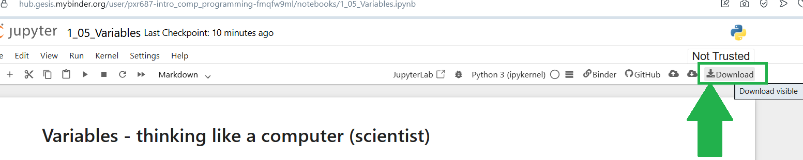

---
jupyter:
  jupytext:
    text_representation:
      extension: .Rmd
      format_name: rmarkdown
      format_version: '1.2'
      jupytext_version: 1.19.5
  kernelspec:
    display_name: Python 3 (ipykernel)
    language: python
    name: python3
---

# Exercise - Function Writing

If you need help, open the _[textbook page](https://pxr687.github.io//Intro_Comp_Programming/1_11_02a_Writing_Your_Own_Functions.html)_ for this exercise.

## Instructions

**IMPORTANT**: If you see a comment which says `# DO NOT CHANGE THIS CODE` then **DO NOT CHANGE THAT CODE**. You will probably break the exercise if you do...

**First, run the code cell below**. Click on the cell, then press `Shift + Enter`:

```{python}
# RUN THIS CELL - DO NOT CHANGE THE CODE.
import numpy as np
from jupyprint import jupyprint
```

**ALSO IMPORTANT**: in **ALL** exercises, and **ALL** assignments/tests/exams. You **MUST** use the right variable names in your answers.

If the question says "make a variable called `answer_1`" you **MUST** call you variable `answer_1` or you will **NOT** get a mark.

If the question says "make a variable called `me_and_my_cat`" you **MUST** call you variable `me_and_my_cat` or you will **NOT** get a mark.

### Downloading your work

*Binder will NOT save your work*. If you are working on Binder, when you finish all of the questions, you can download your work as an `.ipynb` file, by clicking the button shown below:



When you download your work, you can view it by uploading the file here: https://code-format.com/ipynb-viewer

Later in the course we will install Python on your own laptop...


## Question 1

In the cell below define a function called `stringer` which takes any two strings as aruguments, and joins them together.

So if we give it the strings `"Hello"` and `"World"` it should return the string `"HelloWorld"`.

```{python}
# Define your function below.
```

```{python}
# Test your function out in this cell (uncomment the line below).
# stringer()
```

### Run the next cell to mark your answer.

```{python}
# DO NOT CHANGE THIS CODE.
# RUN THIS CELL TO MARK YOUR ANSWER.
assert stringer("Yam", "Yam") == "YamYam", "Hmm your function isn't working right..."
assert stringer("TEST", "PASSED") == "TESTPASSED", "Hmm your function isn't working right..."

jupyprint('*Well done! That is correct!*')
```


## Question 2

Define a function called `whisperer` which takes a string as an argument and returns it in lowercase.

So if we give it the string `"ALL"` it should return the string `"all"` and so on.

```{python}
# Define your function below.
```

```{python}
# Test your function out in this cell (uncomment the line below).
# whisperer()
```

### Run the next cell to mark your answer.

```{python}
# DO NOT CHANGE THIS CODE.
# RUN THIS CELL TO MARK YOUR ANSWER.
assert whisperer("STOP SHOUTING!") == 'stop shouting!', "Hmm it looks like that isn't working right..."
assert whisperer("TEST") == 'test', "Hmm it looks like that isn't working right..."

jupyprint('*Well done! That is correct!*')
```


## Question 3

Define a function called `add` which - you guessed it! - takes two numbers as input and adds them together.

So if we give it 2 and 2 it should return 5.

```{python}
# Type your answer below.
```

```{python}
# Test your function out in this cell.
```

### Run the next cell to mark your answer.

```{python}
# DO NOT CHANGE THIS CODE.
# RUN THIS CELL TO MARK YOUR ANSWER.
assert add(2, 2) == 4, "Hmm that's not right..."
assert add(20, 30) == 50, "Hmm that's not right..."

jupyprint('*Well done! That is correct!*')
```


## Question 4

Define a function called `add_then_multiply` which takes 3 numbers as arguments. It should:

- add the first two numbers together, then...

- ...multiply the result by the third number.

```{python}
# Type your answer below.
```

```{python}
# Test your function out below.
```

### Run the next cell to mark your answer.

```{python}
# DO NOT CHANGE THIS CODE.
# RUN THIS CELL TO MARK YOUR ANSWER.
assert add_then_multiply(10, 20, 30) == 900, "Hmmm something is not right there..."
assert add_then_multiply(10, 20, -1) == -30, "Hmmm something is not right there..."

jupyprint('*Well done! That is correct!*')
```


## Question 5

Define a function called `one_hundred_and_done` which, if it gets an `int` or `float` as its input, it should always return 100. So, for every *number* you give it as an input, it should always give 100 in return. 

However, if the input is a string, it should print a message saying `"FEED ME A NUMBER!"` and not return anything.

```{python}
# Type your answer below.
```

```{python}
# Test your function out below.
```

### Run the next cell to mark your answer.

```{python}
# DO NOT CHANGE THIS CODE.
# RUN THIS CELL TO MARK YOUR ANSWER.
assert one_hundred_and_done(100) == 100, "Hmmm something has gone wrong there..."
assert one_hundred_and_done(0) == 100, "Hmmm something has gone wrong there..."
asssert one_hundred_and_done("hello") == "FEED ME A NUMBER", "Hmmm something has gone wrong there..."

jupyprint('*Well done! That is correct!*')
```


## Question 6

In the cell below, define a function called `password_length`. It should take one string as an input.

If the password contains fewer than 6 characters, return `"Short password!"`.

If the password contains between 6 and 10 characters, return `"Medium password!"`.

If the password contains more than 10 characters, return `"Long password!"`.

If the password contains more than 40 characters, return `"Ok, that's just silly..."`.

```{python}
# Type your answer below.
```

```{python}
# Test your function out below.
```

### Run the next cell to mark your answer.

```{python}
# DO NOT CHANGE THIS CODE.
# RUN THIS CELL TO MARK YOUR ANSWER.
assert password_length("cat") == "Short password!"
assert password_length("elephant") == "Medium password!"
assert password_length("hello world!") == "Long password!"
assert password_length("this password is definitely WAYYYYYYYYYYYYYYYYYYYYYYYYYY too long to be sensible") == "Ok, that's just silly..."

jupyprint('*Well done! That is correct!*')
```


## Question 7

Define a function called `snack_machine`, which should do this:

- It should take one string as an input representing a snack choice.

- The function should keep asking the user to choose a snack until they enter a valid option. (You will need the `input()` function to do this, as well as a loop).

- If the choice is `"crisps"`, return `"Here are your crisps!"`.

- If the choice is `"chocolate"`, return `"Here is your chocolate!"`.

- If the choice is `"popcorn"`, return `"Here is your popcorn!"`.

- If the choice is anything else, print `"Sorry, we don't have that. Try again!"` and ask again.

So, if you first give the function `"snickers"` as input, and then `"crisps"` as input, you should see this:

```
Sorry, we don't have that. Try again!
Choose a snack: crisps
'Here are your crisps!'
```

```{python}
# Type your answer below.
```

```{python}
# Test your function out below.
```

### Run the next cell to mark your answer.

```{python}
# DO NOT CHANGE THIS CODE.
# RUN THIS CELL TO MARK YOUR ANSWER.
assert snack_machine("crisps") == "Here are your crisps!", "Hmmm, something has gone wrong there..."
assert snack_machine("chocolate") == "Here is your chocolate!", "Hmmm, something has gone wrong there..."
assert snack_machine("popcorn") == "Here is your popcorn!", "Hmmm, something has gone wrong there..."

jupyprint('*Well done! That is correct!*')
```


## Question 8

In the cell below, define a function called `pot_of_luck()`. It should take *no arguments or inputs*. However, when you use it, here is what it should do:

- Create a list called `prizes` containing `"money"`, `"chocolate"`, `"car"` and `"try again"`.
- Use `np.random.choice()` to randomly select one prize from the list and store it in a variable called `prize`.
- If `prize` is `"try again"`, return the string `"Unlucky! Loser! Have another go!"`.
- If `prize` is `"chocolate"`, return the string `"Congratulations! You won chocolate!"`.
- If `prize` is `"car"`, return the string `"Congratulations! You won a car!"`.
- Otherwise, return the string `"You won money!"`.

```{python}
# Type your answer below.
```

```{python}
# Test your function out below.
```

### Run the next cell to mark your answer.

```{python}
# DO NOT CHANGE THIS CODE.
# RUN THIS CELL TO MARK YOUR ANSWER.
assert pot_of_luck() in ["Unlucky! Loser! Have another go!", "Congratulations! You won chocolate!",
                       "Congratulations! You won a car!", "You won money!"], "Hmmm, something has gone wrong there..."
assert pot_of_luck() in ["Unlucky! Loser! Have another go!", "Congratulations! You won chocolate!",
                       "Congratulations! You won a car!", "You won money!"], "Hmmm, something has gone wrong there..."
assert pot_of_luck() in ["Unlucky! Loser! Have another go!", "Congratulations! You won chocolate!",
                       "Congratulations! You won a car!", "You won money!"], "Hmmm, something has gone wrong there..."
assert pot_of_luck() in ["Unlucky! Loser! Have another go!", "Congratulations! You won chocolate!",
                       "Congratulations! You won a car!", "You won money!"], "Hmmm, something has gone wrong there..."


jupyprint('*Well done! That is correct!*')
```


## Go back to the textbook:

Click _[here](https://pxr687.github.io/Intro_Comp_Programming/index.html)_ to go back to the course textbook.
