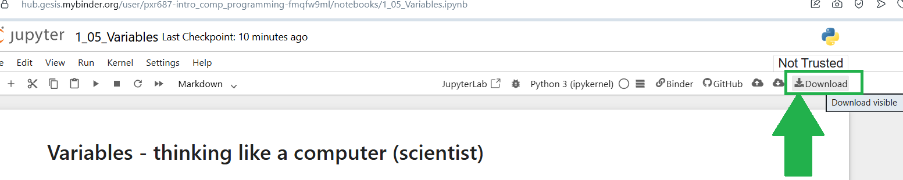

---
jupyter:
  jupytext:
    text_representation:
      extension: .Rmd
      format_name: rmarkdown
      format_version: '1.2'
      jupytext_version: 1.19.5
  kernelspec:
    display_name: Python 3 (ipykernel)
    language: python
    name: python3
---

# Exercise - Making Classes

If you need help, open the _[textbook page](https://pxr687.github.io//Intro_Comp_Programming/1_11_02b_Writing_Your_Own_Classes_and_Methods.html)_ for this exercise.

## Instructions

**IMPORTANT**: If you see a comment which says `# DO NOT CHANGE THIS CODE` then **DO NOT CHANGE THAT CODE**. You will probably break the exercise if you do...

**First, run the code cell below**. Click on the cell, then press `Shift + Enter`:

```{python}
# RUN THIS CELL - DO NOT CHANGE THE CODE.
import numpy as np
from jupyprint import jupyprint
```

**ALSO IMPORTANT**: in **ALL** exercises, and **ALL** assignments/tests/exams. You **MUST** use the right variable names in your answers.

If the question says "make a variable called `answer_1`" you **MUST** call you variable `answer_1` or you will **NOT** get a mark.

If the question says "make a variable called `me_and_my_cat`" you **MUST** call you variable `me_and_my_cat` or you will **NOT** get a mark.

### Downloading your work

*Binder will NOT save your work*. If you are working on Binder, when you finish all of the questions, you can download your work as an `.ipynb` file, by clicking the button shown below:



When you download your work, you can view it by uploading the file here: https://code-format.com/ipynb-viewer


## Part 1 - Fix My Class

### Question 1

Run the cell below to define a class called `Myself` - it is to represent YOU!

```{python}
# Just run this cell.
class Myself:
    name = "PUT_NAME_HERE"
```

Now, make an instance of `Myself` called `me`.

Give it an attribute called `finished_question_1` and set its value to `"YES"`.

```{python}
# Your code here.
```

```{python}
# RUN THIS CELL TO CHECK YOUR ANSWER
assert me.finished_question_1 == "YES", "Hmmm, something has gone wrong there..."
jupyprint("*That is correct, well done!*")
```

### Question 2

Fix the class definition in the cell below.

It should make a class called `Car` which should have two attribues: `brand` and `color`.

When you fix the definition, the code below makes an instance of the class called `my_car`. It gives `my_car`'s `brand` the value `toyota` and `color` the value `red`.

When you fix the definition, you should see this output:

```
toyota
red
Well done for fixing that!
```

```{python}
class Car: brand = "" color = ""


# DO NOT CHANGE THE CODE BELOW HERE.
# Make an instance of the `Car` class.
my_car = Car()
my_car.brand = "toyota"
my_car.color = 'red'

# Show the attributes.
print(my_car.brand)
print(my_car.color)
jupyprint("*Well done for fixing that!*")
```

### Question 3

Fix the class definition in the cell below.

It should make a class called `Book` which should have four attributes: `title`, `author`, `year` and `price`.

When you fix the definition, the code below makes an instance of the class called `book1`. It gives `book1`'s `title` the value `"Harry Potter"`, `author` the value `"J.K. Rowling"`, `year` the value `1997` and `price` the value `15`.

When you fix the definition, you should see this output:

```
Harry Potter
J.K. Rowling
1997
15
Well done for fixing that!
```

```{python}
class Book("object")

    def __init__(self, title, author, year, price):
    self.title = title
    self.author = author
    self.year = year
    self.price = price

# DO NOT CHANGE THE CODE BELOW HERE.
# Create an instance
book1 = Book("Harry Potter", "J.K. Rowling", 1997, 15)

# Display information
print(book1.title)
print(book1.author)
print(book1.year)
print(book1.price)

jupyprint("*Well done for fixing that!*")
```

## Part 2 - Making Your Own Classes


### Question 1

You are going to build an Object Oriented data management system for a zoo.

Let's start by making an `Animal` class.

For now, give it just one attribute: `species`.

Make an instance called `lion` and give its `species` attribute the value: `"panthera leo"`.

```{python}
# Define your class below.
```

```{python}
# Test your class out.
```

### Run the next cell to mark your answer.

```{python}
# DO NOT CHANGE THIS CODE.
# RUN THIS CELL TO MARK YOUR ANSWER.
assert lion.species = "panthera leo", "Hmmm, something is wrong there..."

jupyprint('*Well done! That is correct!*')
```


### Question 2


```{python}
# Define your class below.
```

```{python}
# Test your class out.
```

### Run the next cell to mark your answer.

```{python}
# DO NOT CHANGE THIS CODE.
# RUN THIS CELL TO MARK YOUR ANSWER.


jupyprint('*Well done! That is correct!*')
```


### Question 3


```{python}
# Define your class below.
```

```{python}
# Test your class out.
```

### Run the next cell to mark your answer.

```{python}
# DO NOT CHANGE THIS CODE.
# RUN THIS CELL TO MARK YOUR ANSWER.


jupyprint('*Well done! That is correct!*')
```


### Question 4


```{python}
# Define your class below.
```

```{python}
# Test your class out.
```

### Run the next cell to mark your answer.

```{python}
# DO NOT CHANGE THIS CODE.
# RUN THIS CELL TO MARK YOUR ANSWER.


jupyprint('*Well done! That is correct!*')
```


### Question 5


```{python}
# Define your class below.
```

```{python}
# Test your class out.
```

### Run the next cell to mark your answer.

```{python}
# DO NOT CHANGE THIS CODE.
# RUN THIS CELL TO MARK YOUR ANSWER.


jupyprint('*Well done! That is correct!*')
```


## Go back to the textbook:

Click _[here](https://pxr687.github.io/Intro_Comp_Programming/index.html)_ to go back to the course textbook.
