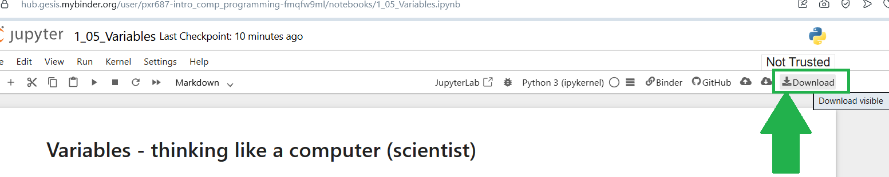

---
jupyter:
  jupytext:
    text_representation:
      extension: .Rmd
      format_name: rmarkdown
      format_version: '1.2'
      jupytext_version: 1.19.5
  kernelspec:
    display_name: Python 3 (ipykernel)
    language: python
    name: python3
---

# Exercise - Plotting Practice 

If you need help, open the _[textbook page](https://pxr687.github.io//Intro_Comp_Programming/1_12_00_Data_Visualization.html)_ for this exercise.

## Instructions

**IMPORTANT**: If you see a comment which says `# DO NOT CHANGE THIS CODE` then **DO NOT CHANGE THAT CODE**. You will probably break the exercise if you do...

**First, run the code cell below**. Click on the cell, then press `Shift + Enter`:

```{python}
# RUN THIS CELL - DO NOT CHANGE THE CODE.
import numpy as np
from jupyprint import jupyprint
```

**ALSO IMPORTANT**: in **ALL** exercises, and **ALL** assignments/tests/exams. You **MUST** use the right variable names in your answers.

If the question says "make a variable called `answer_1`" you **MUST** call you variable `answer_1` or you will **NOT** get a mark.

If the question says "make a variable called `me_and_my_cat`" you **MUST** call you variable `me_and_my_cat` or you will **NOT** get a mark.

### Downloading your work

*Binder will NOT save your work*. If you are working on Binder, when you finish all of the questions, you can download your work as an `.ipynb` file, by clicking the button shown below:



When you download your work, you can view it by uploading the file here: https://code-format.com/ipynb-viewer


## Instructions

In this exercise you will practice data visualisation with `pandas` and `matplotlib`.

**DO NOT USE AI TO DO THIS EXERCISE**. It will just make the graphs for your straight away, and you will not learn how to use `matplotlib` or get a deeper understanding of the Procedural Programming and Object Oriented styles that `matplotlib` can use.

Please use your own brain :)

First, import both libraries in the cell below:

```{python}
import pandas as pd
import matplotlib.pyplot as plt
```

Next, download this dataset: https://raw.githubusercontent.com/odsti/cfd-textbook/refs/heads/main/data/titanic_clean.csv

*Hint*: you can store this as a string variable, and then give it to the `pd.read_csv()` function. Try that in the cell below:

```{python}
# Your code here.
data = ...
```

This dataset has data from the [Titanic](https://en.wikipedia.org/wiki/Titanic) - a famous ship which sank. It has data on features of the passengers, and whether they survived or not.

Now, over to you. Building on the code on the _[textbook page](https://pxr687.github.io//Intro_Comp_Programming/1_12_00_Data_Visualization.html)_, make all of the following graphs, and try to do each one in the Procedural Programming *and* the OOP style, in different code cells.

## Scatterplots

| Plot | Procedural (`plt`) | OOP (`ax`) |
|---|---|---|
| Age vs fare | `plt.scatter()` | `ax.scatter()` |
| Age vs survived | `plt.scatter()` | `ax.scatter()` |
| Fare vs age | `plt.scatter()` | `ax.scatter()` |

Remember to always add labels to each axis and to give your plot a title!

```{python}
# Your code here.
```

## Histograms

| Plot | Procedural (`plt`) | OOP (`ax`) |
|---|---|---|
| Age distribution | `plt.hist()` | `ax.hist()` |
| Fare distribution | `plt.hist()` | `ax.hist()` |

Remember to always add labels to each axis and to give your plot a title!

```{python}
# Your code here.
```

## Boxplots

| Plot | Procedural (`plt`) | OOP (`ax`) |
|---|---|---|
| Age by gender | `plt.boxplot()` | `ax.boxplot()` |
| Age by class | `plt.boxplot()` | `ax.boxplot()` |
| Fare by class | `plt.boxplot()` | `ax.boxplot()` |
| Fare by survived | `plt.boxplot()` | `ax.boxplot()` |
| Age by survived | `plt.boxplot()` | `ax.boxplot()` |

Remember to always add labels to each axis and to give your plot a title!

```{python}
# Your code here.
```

## Done.

You finished the exercise.

## Go back to the textbook:

Click _[here](https://pxr687.github.io/Intro_Comp_Programming/index.html)_ to go back to the course textbook.
