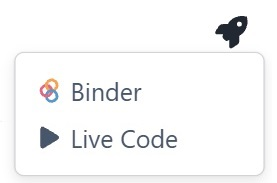

---
jupyter:
  jupytext:
    text_representation:
      extension: .Rmd
      format_name: rmarkdown
      format_version: '1.2'
      jupytext_version: 1.19.5
  kernelspec:
    display_name: Python 3 (ipykernel)
    language: python
    name: python3
---

# Scratchpad

This page is for you to launch on Binder or Live code, so that you can play with Python code whenever you want, in your web browser.



**Or** if you want to be able to save your code use this link: https://pxr687.github.io/scratchpad/
*Note*: you have to use the same browser for your work to be saved, and it will be deleted if you delete your browsing data.

```{python}
# Your code here.
```
